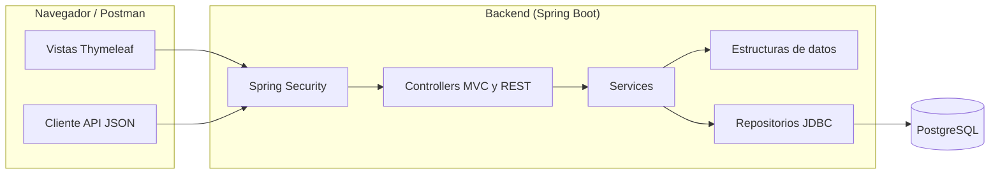

<div align="center">


# Botica San Miguel

**Sistema web de gestión de inventario, compras y preparación de ventas para una botica.**


[Características](#características) ·
[Inicio rápido](#inicio-rápido) ·
[Estilos](#estilos-con-tailwind-css) ·
[Arquitectura](#arquitectura) ·
[Estructuras de datos](#estructuras-de-datos) ·
[API](#api) ·
[Pruebas](#pruebas)

</div>

---

## Descripción

Botica San Miguel es una aplicación web que cubre la operación diaria de una botica: catálogo de medicamentos, control de lotes y vencimientos, entradas y salidas de inventario, órdenes de compra a proveedores, alertas de reposición y preparación de ventas, con acceso diferenciado por rol.

Fue desarrollada como proyecto académico del curso **Algoritmos y Estructura de Datos**, con el objetivo de aplicar estructuras propias y de la biblioteca estándar de Java (lista enlazada, pila y cola de prioridad) a un problema real: la rotación de lotes por vencimiento (FEFO).

> [!NOTE]
> El proyecto está en desarrollo y no está preparado para uso en producción.

## Características

### Inventario

- **Medicamentos:** consulta, creación, edición, activación y desactivación sin borrar el historial.
- **Lotes y existencias:** consulta de lotes por medicamento, con indicador del **lote prioritario FEFO** (primero en vencer, primero en salir).
- **Salidas de inventario:** registro desde un lote o mediante un formulario de salida directa, con validación de existencias.
- **Movimientos:** historial de entradas y salidas con el detalle de cada operación.

### Compras y proveedores

- **Proveedores:** consulta, creación, edición, activación y desactivación.
- **Órdenes de compra:** creación, consulta, cancelación de órdenes pendientes y **recepción total o parcial**, que registra los lotes recibidos y actualiza el estado de la orden (`PENDIENTE`, `PARCIALMENTE_RECIBIDA`, `RECIBIDA`, `CANCELADA`).

### Ventas y clientes

- **Clientes:** consulta, creación y edición.
- **Preparación de venta:** armado de una venta en sesión con asignación automática de lotes por FEFO y opción de **deshacer** (pantalla web en `/ventas/nueva` y API JSON en `/ventas/preparacion`).

### Alertas

Panel de medicamentos **agotados** o con **stock bajo**, reposición sugerida (descontando lo pendiente de recibir), lotes **vencidos** y lotes **por vencer** en los próximos 90 días.

### Control de acceso (RBAC)

| Función                                  | Administrador | Almacenero | Compras | Vendedor |
| :--------------------------------------- | :-----------: | :--------: | :-----: | :------: |
| Consultar medicamentos, lotes y alertas  |      Sí       |     Sí     |   Sí    |    Sí    |
| Crear, editar y desactivar medicamentos  |      Sí       |     No     |   No    |    No    |
| Consultar proveedores                    |      Sí       |     Sí     |   Sí    |    No    |
| Crear y editar proveedores               |      Sí       |     No     |   Sí    |    No    |
| Clientes                                 |      Sí       |     No     |   No    |    Sí    |
| Consultar órdenes de compra              |      Sí       |     Sí     |   Sí    |    No    |
| Crear y cancelar órdenes de compra       |      Sí       |     No     |   Sí    |    No    |
| Recibir órdenes de compra                |      Sí       |     Sí     |   No    |    No    |
| Registrar salidas y consultar movimientos |      Sí       |     Sí     |   No    |    No    |
| Preparación de venta                     |      Sí       |     No     |   No    |    Sí    |

## Stack tecnológico

| Capa                | Tecnologías                                                         |
| :------------------ | :------------------------------------------------------------------ |
| **Backend**         | Java 25, Spring Boot 4.1.2, Spring MVC, Spring JDBC, Bean Validation |
| **Seguridad**       | Spring Security (formulario de acceso para la web y HTTP Basic para la API) |
| **Vistas**          | Thymeleaf, HTML5, Tailwind CSS 3.4 (más CSS propio) y JavaScript sin frameworks de UI |
| **Base de datos**   | PostgreSQL 18                                                       |
| **Pruebas**         | JUnit 5, Spring Test (más de 50 pruebas)                            |
| **Herramientas**    | Maven Wrapper, Node.js y npm (compilación de Tailwind), Docker (multi-stage), Postman |

## Inicio rápido

### Requisitos

- JDK 25 (no solo JRE).
- PostgreSQL 18 y, opcionalmente, pgAdmin 4.
- Node.js (versión LTS) y npm: Maven los invoca para compilar los estilos con Tailwind CSS.
- No necesitas instalar Maven: el proyecto incluye Maven Wrapper.

### 1. Base de datos

Crea una base de datos **nueva** (por ejemplo, `farmacia_aed`) y ejecuta los scripts de la carpeta `scripts/` en este orden:

| Script                    | Contenido                                                                                       |
| :------------------------ | :---------------------------------------------------------------------------------------------- |
| `01_creacion_tablas.sql`  | Estructura completa: 11 tablas, restricciones e índices. Exige que las tablas no existan.       |
| `02_datos_demo.sql`       | Datos ficticios: 4 cuentas, 2 medicamentos, 2 proveedores, un lote, un movimiento y una orden. Exige tablas vacías. |

> [!IMPORTANT]
> Los scripts no usan `DROP`, `DELETE` ni `TRUNCATE`. No los ejecutes sobre una base con datos reales. La guía paso a paso está en [`GUIA_INSTALACION.txt`](GUIA_INSTALACION.txt).

### 2. Dependencias de estilos

Instala las dependencias de Node una sola vez, desde la raíz del proyecto:

```bash
npm install
```

> [!IMPORTANT]
> Maven ejecuta `npm run build:css` en cada compilación (`spring-boot:run`, `test`, `package`). Si omites `npm install`, la compilación falla con el error `tailwindcss: not found`.

### 3. Configuración y ejecución

La conexión se define con variables de entorno:

| Variable      | Descripción                 | Valor por defecto                                |
| :------------ | :-------------------------- | :----------------------------------------------- |
| `DB_URL`      | URL JDBC de la base         | `jdbc:postgresql://localhost:5432/farmacia_aed`  |
| `DB_USER`     | Usuario de PostgreSQL       | `postgres`                                       |
| `DB_PASSWORD` | Contraseña del usuario (obligatoria) | *(Sin valor por defecto; debe definirse siempre)* |
| `PORT`        | Puerto del servidor         | `8080`                                           |

<details>
<summary><b>Windows (PowerShell)</b></summary>

```powershell
$env:DB_USER = "postgres"
$env:DB_PASSWORD = "tu-contraseña-local"

.\mvnw.cmd spring-boot:run
```

</details>

<details>
<summary><b>Linux / macOS</b></summary>

```bash
export DB_USER="postgres"
export DB_PASSWORD="tu-contraseña-local"

./mvnw spring-boot:run
```

</details>

La aplicación quedará disponible en `http://localhost:8080/login`.

### Cuentas de demostración

| Rol           | Usuario         |
| :------------ | :-------------- |
| Administrador | `admin_demo`    |
| Almacenero    | `almacen_demo`  |
| Compras       | `compras_demo`  |
| Vendedor      | `vendedor_demo` |

## Estilos con Tailwind CSS

La interfaz combina Tailwind CSS con las hojas de estilo propias del proyecto (`estilos.css` e `inventario.css`). El `preflight` de Tailwind está desactivado para que ambos convivan sin conflictos, y la paleta de la botica se define en `tailwind.config.js` (colores `botica` y `alerta`).

| Archivo                                      | Función                                                               |
| :------------------------------------------- | :-------------------------------------------------------------------- |
| `src/main/resources/static/css/tailwind-input.css` | Entrada de Tailwind.                                            |
| `src/main/resources/static/css/tailwind.css` | Salida minificada generada; se versiona en el repositorio.            |
| `tailwind.config.js`                         | Rutas que Tailwind escanea (`templates/` y `static/js/`) y paleta.    |

| Comando               | Uso                                                                                     |
| :-------------------- | :-------------------------------------------------------------------------------------- |
| `npm run build:css`   | Genera `tailwind.css` minificado. Maven lo ejecuta automáticamente al compilar.         |
| `npm run watch:css`   | Regenera `tailwind.css` al guardar cambios en las plantillas; útil mientras editas la interfaz. |

## Arquitectura



El backend sigue una arquitectura en capas (controller, service, repository) con acceso a datos mediante JDBC directo, lo que mantiene explícitas las consultas y las transacciones. Hay dos cadenas de seguridad: una para la API (`/api/**`, sin estado y con HTTP Basic) y otra para la web (sesión con formulario de acceso).

## Estructuras de datos

El curso se centra en estructuras de datos; estas son las que usa el sistema (paquete `com.farmacia.estructuras`):

| Estructura                                         | Clase                | Aplicación                                                                                                                                              |
| :------------------------------------------------- | :------------------- | :------------------------------------------------------------------------------------------------------------------------------------------------------ |
| **Lista simplemente enlazada** (implementación propia) | `ListaEnlazada`      | Líneas de la preparación de venta, que conservan su orden de ingreso. Permite agregar, buscar, reemplazar y eliminar por criterio.                      |
| **Pila (LIFO)**                                    | `PilaDeshacer`       | Historial de instantáneas para deshacer cambios en la preparación de venta.                                                                             |
| **Cola de prioridad**                              | `ColaPrioridadLotes` | Orden FEFO: primero el lote con vencimiento más cercano (desempata por ID). Se usa para planificar salidas e identificar el lote prioritario de cada medicamento. |

`PilaDeshacer` se apoya en `ArrayDeque` y `ColaPrioridadLotes` en `PriorityQueue`; `ListaEnlazada` está implementada con nodos propios.

## API

La web convive con una API JSON que usa la misma base de datos y requiere HTTP Basic.

| Recurso             | Operaciones                                                | Roles                                     |
| :------------------ | :--------------------------------------------------------- | :---------------------------------------- |
| `/api/medicamentos` | `GET`, `POST`, `PUT` y `DELETE` (desactiva)                | Consulta: todos. Escritura: Administrador |
| `/api/clientes`     | `GET`, `POST` y `PUT`                                      | Administrador y Vendedor                  |
| `/api/alertas`      | `GET` en `/stock`, `/reposicion`, `/vencidos` y `/por-vencer` | Todos los roles                           |

La preparación de venta (`/ventas/preparacion`) también responde JSON, pero usa la sesión iniciada en la web, no HTTP Basic.

Consulta [`API_POSTMAN.md`](API_POSTMAN.md) y la colección de la carpeta `POSTMAN/` para probar la API de medicamentos.

## Seguridad

- **Contraseñas:** almacenadas con hash BCrypt (`DelegatingPasswordEncoder`).
- **Autorización por rol:** cada ruta declara explícitamente los roles permitidos y las rutas no listadas de la API se deniegan por defecto.
- **API sin estado:** sin sesión y con CSRF desactivado solo en `/api/**`; la web mantiene la protección habitual de Spring Security.
- **Desactivación lógica:** los medicamentos y proveedores no se borran, para conservar el historial.
- **Contenedor:** la imagen Docker se ejecuta con un usuario sin privilegios.

## Pruebas

```bash
npm install   # solo la primera vez
./mvnw test
```

Incluye pruebas unitarias de las estructuras de datos y de los servicios, y pruebas de controladores. Las pruebas de persistencia (`*PersistenciaTest`) usan `@SpringBootTest` y requieren una base PostgreSQL con los scripts de `scripts/` y las variables de entorno configuradas.

## Despliegue con Docker

El `Dockerfile` compila la aplicación con Java 25 y genera una imagen ligera que lee el puerto desde `PORT`; está pensado para plataformas como Render.

```bash
docker build -t botica-san-miguel .
docker run -p 8080:8080 \
  -e DB_URL="jdbc:postgresql://host:5432/farmacia_aed" \
  -e DB_USER="usuario" -e DB_PASSWORD="contraseña" \
  botica-san-miguel
```

> [!WARNING]
> Antes de publicar cualquier instancia, cambia o elimina las cuentas de demostración y configura tus propias credenciales de base de datos.

## Estado del proyecto

En desarrollo. Pendiente según el código actual:

- Confirmar la venta: la preparación de venta aún no se guarda en las tablas `venta` y `detalle_venta`.
- Ampliar la colección de Postman a clientes y alertas.

## Estructura del proyecto

```text
botica-san-miguel/
├── src/
│   ├── main/
│   │   ├── java/com/farmacia/
│   │   │   ├── config/        # Seguridad: cadenas web y API
│   │   │   ├── controller/    # Controladores MVC y REST
│   │   │   ├── service/       # Lógica de negocio y transacciones
│   │   │   ├── repository/    # Acceso a datos con JDBC
│   │   │   ├── estructuras/   # ListaEnlazada, PilaDeshacer, ColaPrioridadLotes
│   │   │   ├── model/         # Entidades y vistas de dominio
│   │   │   └── dto/           # Formularios y objetos de transferencia
│   │   └── resources/
│   │       ├── templates/     # Vistas Thymeleaf por módulo
│   │       ├── static/        # CSS (propio y Tailwind generado), JS (preparacion-venta.js), imágenes e iconos
│   │       └── application.properties
│   └── test/java/             # Pruebas unitarias, de controladores y de persistencia
├── scripts/                   # Scripts SQL de tablas y datos de demostración
├── POSTMAN/                   # Colección de Postman
├── API_POSTMAN.md             # Guía de la API de medicamentos
├── package.json               # Dependencias de Node y scripts de Tailwind (build:css, watch:css)
├── tailwind.config.js         # Configuración y paleta de Tailwind CSS
├── GUIA_INSTALACION.txt       # Instalación paso a paso en Windows
├── Dockerfile
├── .dockerignore
└── pom.xml
```
