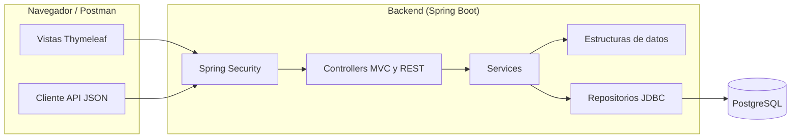

<div align="center">


# Botica San Miguel

**Sistema web de gestión de inventario, compras y preparación de ventas para una botica.**


[Características](#características) ·
[Inicio rápido](#inicio-rápido) ·
[Estilos](#estilos-con-tailwind-css) ·
[Arquitectura](#arquitectura) ·
[Estructuras de datos](#estructuras-de-datos) ·
[API](#api) ·
[Pruebas](#pruebas)

</div>

---

## Descripción

Botica San Miguel es una aplicación web que cubre la operación diaria de una botica: catálogo de medicamentos, control de lotes y vencimientos, entradas y salidas de inventario, órdenes de compra a proveedores, alertas de reposición y preparación de ventas, con acceso diferenciado por rol.

Fue desarrollada como proyecto académico del curso **Algoritmos y Estructura de Datos**, con el objetivo de aplicar estructuras propias y de la biblioteca estándar de Java (lista enlazada, pila y cola de prioridad) a un problema real: la rotación de lotes por vencimiento (FEFO).

> [!NOTE]
> El proyecto está en desarrollo y no está preparado para uso en producción.

## Características

### Inventario

- **Medicamentos:** consulta, creación, edición, activación y desactivación sin borrar el historial.
- **Categorías taxonómicas y árbol n-ario:** organización jerárquica de medicamentos (`/categorias`), con cálculo de stock disponible agregado por rama mediante DFS, alertas de inventario y filtro por categoría con descendientes en el catálogo.
- **Lotes y existencias:** consulta de lotes por medicamento, con indicador del **lote prioritario FEFO** (primero en vencer, primero en salir).
- **Existencias iniciales:** registro directo de stock inicial de lotes sin orden de compra (`/inventario/existencias-iniciales`, ADMINISTRADOR y ALMACENERO), con motivo, validación de lote duplicado (RN-04) y opción de confirmar acumulación de existencias en lotes preexistentes con la misma fecha de vencimiento.
- **Salidas de inventario:** registro desde un lote o mediante un formulario de salida directa, con validación de existencias. Incluye la opción de dar de baja lotes vencidos directamente desde el panel de alertas con motivo precargado (`?motivo=Baja por vencimiento`).
- **Movimientos y Kardex:** historial de entradas y salidas (`/movimientos`, ADMINISTRADOR y ALMACENERO) con filtros avanzados por tipo (`ENTRADA`/`SALIDA`), fechas, motivo, medicamento, número de lote y usuario responsable, columna de origen calculada (`Recepción de compra`, `Existencia inicial`, `Venta`, `Otra salida`), cantidad afectada y paginación (20 por página).

### Compras y proveedores

- **Proveedores:** consulta, creación, edición, activación y desactivación.
- **Órdenes de compra:** creación, consulta, cancelación de órdenes pendientes y **recepción total o parcial**, que registra los lotes recibidos y actualiza el estado de la orden (`PENDIENTE`, `PARCIALMENTE_RECIBIDA`, `RECIBIDA`, `CANCELADA`).

### Ventas y clientes

- **Clientes:** consulta, creación y edición.
- **Preparación de venta:** armado de una venta en sesión con asignación automática de lotes por FEFO y opción de **deshacer** (pantalla web en `/ventas/nueva` y API JSON en `/ventas/preparacion`).
- **Descuentos por línea:** importe fijo en soles por línea (`0 ≤ descuento ≤ cantidad × precio`), editable en la tabla de la preparación (`PUT /ventas/preparacion/{idMedicamento}/descuento`) y reversible con **deshacer**. Al confirmar, el descuento de cada línea se reparte entre sus lotes en proporción a la cantidad (el último lote absorbe el redondeo) y el comprobante muestra subtotal, descuento y total. La regla de cálculo es una política intercambiable (`PoliticaDescuento`, patrón Strategy).
- **Confirmación de venta:** `POST /ventas/confirmar` (cliente opcional, por defecto "Público general"). En una sola transacción vuelve a planificar FEFO contra la base, descuenta cada lote con un UPDATE condicional (stock suficiente y lote vigente) en orden ascendente de `id_lote`, y guarda la venta, su detalle por lote (precio congelado) y la salida de inventario. Si el stock cambió o un lote venció, se rechaza completa y la preparación se conserva.
- **Comprobante interno:** `/ventas/{id}` con número correlativo `B001-00000001` (secuencia de PostgreSQL), una línea por lote y botón **Imprimir** con formato de ticket de 80 mm. El vendedor solo ve sus ventas; el administrador, todas.
- **Historial de ventas:** `/ventas` (solo ADMINISTRADOR) con filtros por fecha (últimos 30 días por defecto), vendedor y número de comprobante, paginación (20 por página), suma total acumulada y enlaces directos a cada comprobante.
- **Mis ventas:** `/ventas/mias` (solo VENDEDOR) para consultar y reimprimir comprobantes propios de hasta los últimos 30 días, sin totales del período.

### Alertas

Panel de medicamentos **agotados** o con **stock bajo**, reposición sugerida (descontando lo pendiente de recibir), lotes **vencidos** y lotes **por vencer** en los próximos 90 días (configurable con `DIAS_POR_VENCER`).

### Auditoría

Bitácora **de solo inserción** (`/auditoria`, solo ADMINISTRADOR) con filtros por fecha, usuario, acción, entidad y resultado, paginación y exportación CSV. Registra:

- **Accesos:** inicios de sesión correctos y fallidos (con el usuario escrito, nunca la clave), cierres de sesión y accesos denegados por rol (método y ruta).
- **Cambios de datos:** altas, ediciones (qué campo cambió, antes → después), activaciones y desactivaciones de medicamentos y proveedores; altas y ediciones de clientes (sin guardar sus datos personales); creación, recepción y cancelación de órdenes de compra; otras salidas y ventas confirmadas; altas, ediciones, cambios de rol, restablecimiento de contraseñas, activaciones y desactivaciones de usuarios (sin incluir contraseñas ni hashes).

Un trigger impide modificar o borrar eventos incluso con SQL directo. Los cambios de datos se registran **en la misma transacción** que la operación (si esta se revierte, el evento tampoco queda); los accesos, en una transacción propia (quedan aunque la operación falle).

### Usuarios y seguridad

- **Gestión de usuarios:** mantenimiento integral (`/usuarios`, solo ADMINISTRADOR) para dar de alta y editar usuarios asignando roles (`ADMINISTRADOR`, `VENDEDOR`, `ALMACENERO`, `COMPRAS`).
- **Control de estados y reglas:** activación y desactivación de usuarios conservando el historial. Protección estricta que impide desactivar o cambiar de rol al último administrador activo, e impide desactivarse a uno mismo (RN-18).
- **Restablecimiento de contraseñas:** cambio seguro de contraseñas sin exponer claves ni hashes en las vistas (`CA-4.2`), con validación de complejidad (≥ 10 caracteres alfanuméricos).
- **Invalidación inmediata de sesiones:** al desactivar una cuenta o alterar el rol, `SessionRegistry` invalida la sesión activa en el acto, rechazando su siguiente petición protegida y redirigiendo al login con aviso (`CA-5.1`, `CA-5.2`).

### Reportes de gestión y exportación CSV

Módulo gerencial exclusivo para el rol `ADMINISTRADOR` (`/reportes`), con visualización interactiva y descarga en formato CSV bajo norma RFC 4180 (con escape estricto de comas, comillas, saltos de línea y mitigación de inyección de fórmulas) y registro obligatorio del evento de auditoría `EXPORTAR`:

- **Ventas por período (`/reportes/ventas`):** consolidado diario con cantidad de transacciones, subtotal, descuentos acumulados y total neto. Rango configurable (por defecto últimos 30 días, validación contra rangos invertidos o superiores a 366 días).
- **Medicamentos más vendidos (`/reportes/mas-vendidos`):** ranking de rotación ordenado por unidades vendidas descendente (agregando ventas multi-lote) y nombre ascendente, con límite configurable (10 por defecto).
- **Mermas de inventario (`/reportes/mermas`):** unidades dadas de baja por salidas sin venta asociadas en el período, agrupadas por medicamento.
- **Inventario actual (`/reportes/inventario`):** estado de existencias activas discriminando stock disponible (lotes vigentes según reloj del sistema), stock vencido y stock mínimo, con cálculo dinámico de semáforo (`OK`, `STOCK_BAJO`, `AGOTADO`), filtro por estado y detalle expandible de lotes por medicamento (número de lote, fecha de vencimiento, stock actual y días restantes para vencer).
- **Estado de compras (`/reportes/compras`):** seguimiento integral de órdenes de compra con cálculo de unidades solicitadas, recibidas (a través de movimientos de entrada) y saldos pendientes, filtrable por rango de fechas, estado de la orden y proveedor, complementado con tarjetas métricas de consolidado por estado.
- **Panel resumen (`/reportes/panel`):** tablero ejecutivo con volumen de ventas mensual en soles y transacciones, ticket promedio, medicamentos en alerta de stock y lotes por vencer reutilizando el motor `AlertaInventarioServicio`.

### Control de acceso (RBAC)

| Función                                  | Administrador | Almacenero | Compras | Vendedor |
| :--------------------------------------- | :-----------: | :--------: | :-----: | :------: |
| Consultar medicamentos, lotes y alertas  |      Sí       |     Sí     |   Sí    |    Sí    |
| Consultar árbol y categorías (`/categorias`) |  Sí       |     Sí     |   Sí    |    Sí    |
| Crear, editar y desactivar categorías    |      Sí       |     No     |   No    |    No    |
| Crear, editar y desactivar medicamentos  |      Sí       |     No     |   No    |    No    |
| Consultar proveedores                    |      Sí       |     Sí     |   Sí    |    No    |
| Crear y editar proveedores               |      Sí       |     No     |   Sí    |    No    |
| Clientes                                 |      Sí       |     No     |   No    |    Sí    |
| Consultar órdenes de compra              |      Sí       |     Sí     |   Sí    |    No    |
| Crear y cancelar órdenes de compra       |      Sí       |     No     |   Sí    |    No    |
| Recibir órdenes de compra                |      Sí       |     Sí     |   No    |    No    |
| Existencias iniciales                    |      Sí       |     Sí     |   No    |    No    |
| Registrar salidas y consultar movimientos |      Sí       |     Sí     |   No    |    No    |
| Preparación de venta                     |      Sí       |     No     |   No    |    Sí    |
| Confirmar venta y ver comprobante        |   Sí (todas)  |     No     |   No    | Sí (las suyas) |
| Historial general de ventas (`/ventas`)  |      Sí       |     No     |   No    |    No    |
| Mis ventas (`/ventas/mias`)              |      No       |     No     |   No    | Sí (las suyas) |
| Gestión de usuarios (`/usuarios`)        |      Sí       |     No     |   No    |    No    |
| Consultar y exportar la auditoría        |      Sí       |     No     |   No    |    No    |
| Reportes gerenciales y CSV (`/reportes`) |      Sí       |     No     |   No    |    No    |

## Stack tecnológico

| Capa                | Tecnologías                                                         |
| :------------------ | :------------------------------------------------------------------ |
| **Backend**         | Java 25, Spring Boot 4.1.2, Spring MVC, Spring JDBC, Bean Validation |
| **Seguridad**       | Spring Security (formulario de acceso para la web y HTTP Basic para la API) |
| **Vistas**          | Thymeleaf, HTML5, Tailwind CSS 3.4 (más CSS propio) y JavaScript sin frameworks de UI |
| **Base de datos**   | PostgreSQL 18, migraciones con Flyway                               |
| **Pruebas**         | JUnit 5, Spring Test, Testcontainers (376 pruebas)                  |
| **Herramientas**    | Maven Wrapper, Node.js y npm (compilación de Tailwind), Docker (multi-stage), Postman |

## Inicio rápido

### Requisitos

- JDK 25 (no solo JRE).
- PostgreSQL 18 y, opcionalmente, pgAdmin 4.
- Node.js (versión LTS) y npm: Maven los invoca para compilar los estilos con Tailwind CSS.
- No necesitas instalar Maven: el proyecto incluye Maven Wrapper.

### 1. Base de datos

Crea una base de datos **vacía** (por ejemplo, `farmacia_aed`). No hace falta ejecutar scripts a mano: el esquema lo crea y actualiza **Flyway** al iniciar la aplicación.

| Ubicación (`src/main/resources/`)   | Contenido                                                                                       |
| :---------------------------------- | :---------------------------------------------------------------------------------------------- |
| `db/migration/V1__esquema_inicial.sql` | Estructura completa: 11 tablas, restricciones y claves. Se aplica siempre.                   |
| `db/migration/V2__migracion_3fn.sql` | `movimiento_inventario` en 3FN (sin `id_proveedor`: el proveedor se obtiene por la orden), trigger de coherencia movimiento–detalle y 10 índices (`idx_*`, incluido el parcial `idx_lote_fefo`). |
| `db/migration/V3__secuencia_comprobante.sql` | Secuencia del número de comprobante `B001-########`. |
| `db/migration/V4__auditoria.sql` | Tabla `auditoria` de solo inserción (trigger que rechaza `UPDATE`/`DELETE`), acciones y resultados de lista cerrada e índices por fecha y usuario. |
| `db/migration/V5__categorias.sql` | Jerarquía de categorías (tabla `categoria`, `id_padre` reflexivo, índice único por nivel e `id_categoria` opcional en `medicamento`). |
| `db/migration/V<n>__*.sql`          | Cambios posteriores del esquema, en orden de versión. Una migración aplicada nunca se edita.   |
| `db/demo/R__datos_demo.sql`         | Datos ficticios: 4 cuentas, 2 medicamentos, 2 proveedores, un lote, un movimiento y una orden. **Solo con el perfil `demo`**; no inserta nada si la base ya tiene datos. |

Para cargar también los datos de demostración:

```bash
./mvnw spring-boot:run -Dspring-boot.run.profiles=demo
```

> [!IMPORTANT]
> **Base creada antes con los scripts manuales:** al primer arranque, Flyway la marca como versión 1 (`baseline-on-migrate`) y solo le aplica las migraciones posteriores; no borra ni recrea tablas. Las migraciones aplicadas quedan registradas en la tabla `flyway_schema_history`. La guía paso a paso está en [`GUIA_INSTALACION.txt`](GUIA_INSTALACION.txt).

### 2. Dependencias de estilos

Instala las dependencias de Node una sola vez, desde la raíz del proyecto:

```bash
npm install
```

> [!IMPORTANT]
> Maven ejecuta `npm run build:css` en cada compilación (`spring-boot:run`, `test`, `package`). Si omites `npm install`, la compilación falla con el error `tailwindcss: not found`.

### 3. Configuración y ejecución

La conexión se define con variables de entorno:

| Variable      | Descripción                 | Valor por defecto                                |
| :------------ | :-------------------------- | :----------------------------------------------- |
| `DB_URL`      | URL JDBC de la base         | `jdbc:postgresql://localhost:5432/farmacia_aed`  |
| `DB_USER`     | Usuario de PostgreSQL       | `postgres`                                       |
| `DB_PASSWORD` | Contraseña del usuario (obligatoria) | *(Sin valor por defecto; debe definirse siempre)* |
| `PORT`        | Puerto del servidor         | `8080`                                           |
| `DIAS_POR_VENCER` | Horizonte de la alerta "por vencer" (propiedad `farmacia.alertas.dias-por-vencer`) | `90` |

<details>
<summary><b>Windows (PowerShell)</b></summary>

```powershell
$env:DB_USER = "postgres"
$env:DB_PASSWORD = "tu-contraseña-local"

.\mvnw.cmd spring-boot:run
```

</details>

<details>
<summary><b>Linux / macOS</b></summary>

```bash
export DB_USER="postgres"
export DB_PASSWORD="tu-contraseña-local"

./mvnw spring-boot:run
```

</details>

La aplicación quedará disponible en `http://localhost:8080/login`.

### Cuentas de demostración

| Rol           | Usuario         |
| :------------ | :-------------- |
| Administrador | `admin_demo`    |
| Almacenero    | `almacen_demo`  |
| Compras       | `compras_demo`  |
| Vendedor      | `vendedor_demo` |

## Estilos con Tailwind CSS

La interfaz combina Tailwind CSS con las hojas de estilo propias del proyecto (`estilos.css` e `inventario.css`). El `preflight` de Tailwind está desactivado para que ambos convivan sin conflictos, y la paleta de la botica se define en `tailwind.config.js` (colores `botica` y `alerta`).

| Archivo                                      | Función                                                               |
| :------------------------------------------- | :-------------------------------------------------------------------- |
| `src/main/resources/static/css/tailwind-input.css` | Entrada de Tailwind.                                            |
| `src/main/resources/static/css/tailwind.css` | Salida minificada generada; se versiona en el repositorio.            |
| `tailwind.config.js`                         | Rutas que Tailwind escanea (`templates/` y `static/js/`) y paleta.    |

| Comando               | Uso                                                                                     |
| :-------------------- | :-------------------------------------------------------------------------------------- |
| `npm run build:css`   | Genera `tailwind.css` minificado. Maven lo ejecuta automáticamente al compilar.         |
| `npm run watch:css`   | Regenera `tailwind.css` al guardar cambios en las plantillas; útil mientras editas la interfaz. |

## Arquitectura



El backend sigue una arquitectura en capas (controller, service, repository) con acceso a datos mediante JDBC directo, lo que mantiene explícitas las consultas y las transacciones. Hay dos cadenas de seguridad: una para la API (`/api/**`, sin estado y con HTTP Basic) y otra para la web (sesión con formulario de acceso).

## Estructuras de datos

El curso se centra en estructuras de datos; estas son las que usa el sistema (paquete `com.farmacia.estructuras`):

| Estructura                                         | Clase                | Aplicación                                                                                                                                              |
| :------------------------------------------------- | :------------------- | :------------------------------------------------------------------------------------------------------------------------------------------------------ |
| **Lista simplemente enlazada** (implementación propia) | `ListaEnlazada`      | Líneas de la preparación de venta, que conservan su orden de ingreso. Permite agregar, buscar, reemplazar y eliminar por criterio.                      |
| **Pila (LIFO)**                                    | `PilaDeshacer`       | Historial de instantáneas para deshacer cambios en la preparación de venta.                                                                             |
| **Cola de prioridad**                              | `ColaPrioridadLotes` | Orden FEFO: primero el lote con vencimiento más cercano (desempata por ID). El criterio lo aporta la política `PoliticaFefo` (patrón Strategy); se usa para planificar salidas y ventas e identificar el lote prioritario de cada medicamento. |
| **Árbol n-ario jerárquico**                        | `ArbolCategorias`    | Taxonomía jerárquica de categorías de medicamentos (Analgésicos → Antiinflamatorios → AINEs). Búsqueda O(1) con mapa indexado, ascenso por ruta O(h) y cálculo de stock y alertas agregados por rama mediante recorrido en profundidad (DFS) O(k). |

`PilaDeshacer` se apoya en `ArrayDeque`, `ColaPrioridadLotes` en `PriorityQueue` y `ArbolCategorias` en nodos n-arios con mapa auxiliar de acceso directo; `ListaEnlazada` está implementada con nodos y punteros propios.

## API

La web convive con una API JSON que usa la misma base de datos y requiere HTTP Basic.

| Recurso             | Operaciones                                                | Roles                                     |
| :------------------ | :--------------------------------------------------------- | :---------------------------------------- |
| `/api/medicamentos` | `GET`, `POST`, `PUT` y `DELETE` (desactiva)                | Consulta: todos. Escritura: Administrador |
| `/api/clientes`     | `GET`, `POST` y `PUT`                                      | Administrador y Vendedor                  |
| `/api/alertas`      | `GET` en `/stock`, `/reposicion`, `/vencidos` y `/por-vencer` | Todos los roles                           |

La preparación de venta (`/ventas/preparacion`) también responde JSON, pero usa la sesión iniciada en la web, no HTTP Basic.

Consulta [`API_POSTMAN.md`](API_POSTMAN.md) y la colección de la carpeta `POSTMAN/` para probar la API de medicamentos.

## Seguridad

- **Contraseñas:** almacenadas con hash BCrypt (`DelegatingPasswordEncoder`).
- **Autorización por rol y seguridad por defecto:** cada ruta declara explícitamente los roles permitidos; tanto en la web como en la API, **las rutas no declaradas se deniegan** (403). `MatrizRutasTest` recorre todas las rutas con los cuatro roles y sin sesión, de modo que un cambio accidental de permisos hace fallar las pruebas. Toda ruta nueva debe añadirse a `SeguridadConfiguracion` y a esa prueba.
- **Errores sin detalles internos:** 403, 404 y 500 usan páginas propias (`templates/error/`) con un mensaje en español y un enlace al inicio; nunca muestran trazas, excepciones ni SQL (`server.error.include-*=never`). La API sigue respondiendo JSON `{ "mensaje": … }`.
- **Sesión expirada:** la pantalla de venta detecta la sesión vencida (redirección al login, 401 o token CSRF rechazado) y muestra "Tu sesión expiró" con un enlace para volver a entrar, sin bloquear la pantalla.
- **API sin estado:** sin sesión y con CSRF desactivado solo en `/api/**`; la web mantiene la protección habitual de Spring Security.
- **Desactivación lógica:** los medicamentos y proveedores no se borran, para conservar el historial.
- **Contenedor:** la imagen Docker se ejecuta con un usuario sin privilegios.

## Pruebas

```bash
npm install   # solo la primera vez
./mvnw test
```

Incluye pruebas unitarias de las estructuras de datos y de los servicios, y pruebas de controladores. Todas las pruebas de integración y persistencia usan Testcontainers (`postgres:18-alpine`): **requieren Docker en ejecución, pero no una base PostgreSQL local ni las variables `DB_*`**. Flyway crea el esquema en el contenedor con las mismas migraciones que la aplicación, así que las pruebas nunca modifican tu base de desarrollo.

## Despliegue con Docker

El `Dockerfile` compila la aplicación con Java 25 y genera una imagen ligera que lee el puerto desde `PORT`; está pensado para plataformas como Render.

```bash
docker build -t botica-san-miguel .
docker run -p 8080:8080 \
  -e DB_URL="jdbc:postgresql://host:5432/farmacia_aed" \
  -e DB_USER="usuario" -e DB_PASSWORD="contraseña" \
  botica-san-miguel
```

> [!WARNING]
> Antes de publicar cualquier instancia, cambia o elimina las cuentas de demostración y configura tus propias credenciales de base de datos.

## Estado del proyecto

En desarrollo. Pendiente según el código actual:

- Historial de ventas y kardex con filtros (spec 005), existencias iniciales (006), gestión de usuarios (007), reportes (008) y árbol de categorías (009).
- Ampliar la colección de Postman a clientes y alertas.

## Estructura del proyecto

```text
botica-san-miguel/
├── src/
│   ├── main/
│   │   ├── java/com/farmacia/
│   │   │   ├── config/        # Seguridad: cadenas web y API
│   │   │   ├── controller/    # Controladores MVC y REST
│   │   │   ├── service/       # Lógica de negocio y transacciones
│   │   │   ├── repository/    # Acceso a datos con JDBC
│   │   │   ├── estructuras/   # ListaEnlazada, PilaDeshacer, ColaPrioridadLotes
│   │   │   ├── model/         # Entidades y vistas de dominio
│   │   │   └── dto/           # Formularios y objetos de transferencia
│   │   └── resources/
│   │       ├── templates/     # Vistas Thymeleaf por módulo
│   │       ├── static/        # CSS (propio y Tailwind generado), JS (preparacion-venta.js), imágenes e iconos
│   │       ├── db/migration/  # Migraciones Flyway del esquema (V1__, V2__, ...)
│   │       ├── db/demo/       # Datos de demostración (perfil demo)
│   │       ├── application.properties
│   │       └── application-demo.properties
│   └── test/java/             # Pruebas unitarias, de controladores y de persistencia
├── POSTMAN/                   # Colección de Postman
├── API_POSTMAN.md             # Guía de la API de medicamentos
├── package.json               # Dependencias de Node y scripts de Tailwind (build:css, watch:css)
├── tailwind.config.js         # Configuración y paleta de Tailwind CSS
├── GUIA_INSTALACION.txt       # Instalación paso a paso en Windows
├── Dockerfile
├── .dockerignore
└── pom.xml
```
